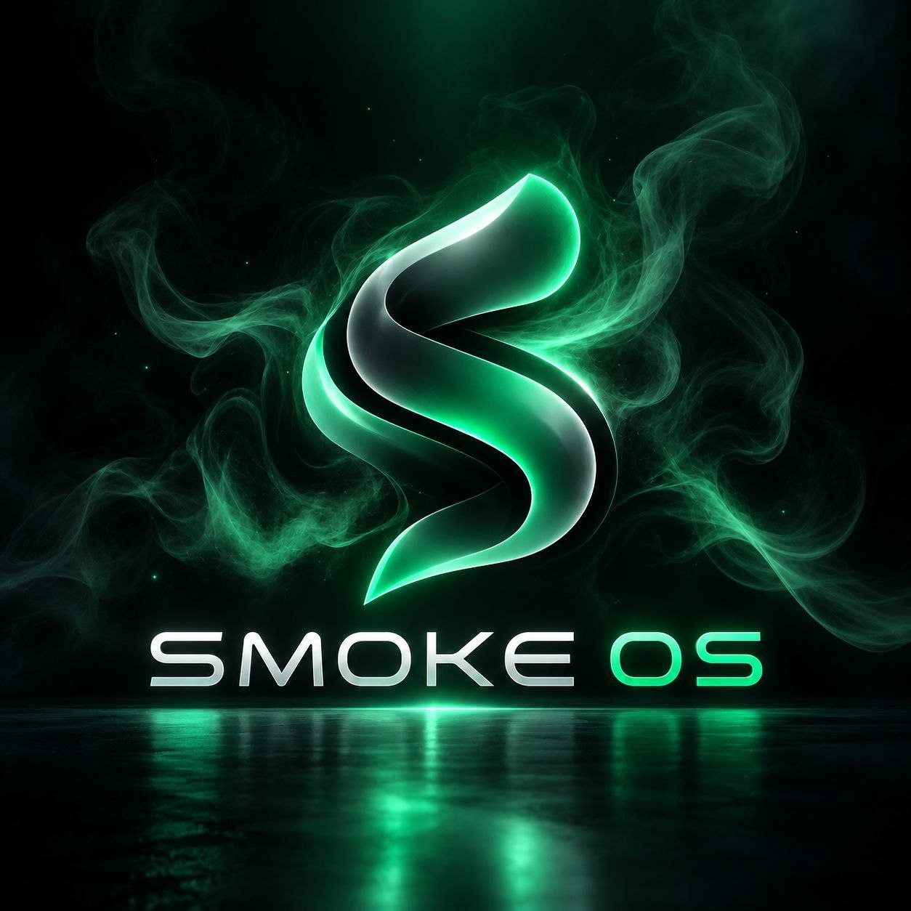

<div align="center">

<p align="center">
  
</p>

# 🌫️ SMOKE OS
**Less clutter. More control. Pure Linux.**

[](https://smoke-os.github.io)
[](https://github.com/SMOKE-OS/smoke-iso/releases)
[](https://archlinux.org/)
[](https://hyprland.org/)
[](https://github.com/SMOKE-OS)

<p align="center">
  <a href="https://smoke-os.github.io"><b>🌐 Official Website</b></a> &nbsp;&bull;&nbsp;
  <a href="https://github.com/SMOKE-OS/smoke-iso/releases"><b>💿 Download Live ISO</b></a> &nbsp;&bull;&nbsp;
  <a href="https://github.com/SMOKE-OS/smoke-configs"><b>⚙️ Desktop Dotfiles</b></a> &nbsp;&bull;&nbsp;
  <a href="https://smoke-os.github.io/#quickstart"><b>🚀 Quickstart Guide</b></a>
</p>

---

</div>

## 🌫️ About SMOKE OS

**SMOKE OS** is an independent, minimal Linux distribution crafted on top of **Arch Linux** and tailored around the **Hyprland** dynamic tiling Wayland compositor and **Quickshell**.

Our mission is to deliver a sleek, coherent, and ultra-responsive desktop experience out of the box—eliminating background bloat while preserving user freedom, granular extensibility, and peak performance.

> *"Find clarity in the chaos."*

---

## 📦 Project Ecosystem

| Repository | Purpose | Key Components |
| :--- | :--- | :--- |
| 💿 [**smoke-iso**](https://github.com/SMOKE-OS/smoke-iso) | Official `archiso` build recipes and automated GitHub Actions CI/CD release pipeline | Archiso, systemd-boot, Plymouth |
| ⚙️ [**smoke-configs**](https://github.com/SMOKE-OS/smoke-configs) | Single source of truth for desktop dotfiles, themes, and interactive setup installer | Hyprland, Quickshell, Kitty |
| 🌐 [**SMOKE-OS.github.io**](https://github.com/SMOKE-OS/SMOKE-OS.github.io) | Official landing website, live release tracker, and interactive keybinding cheat sheet | Static Web Portal, Releases API |
| 📁 [**SMOKE-OS/.github**](https://github.com/SMOKE-OS/.github) | Organization profile, community health files, and default repository templates | Profile README, Health Specs |

---

## ⚡ Instant Test Drive (QEMU)

Test SMOKE OS safely in a virtual machine with full Wayland hardware acceleration without altering disk partitions:

```bash
# Launch the live ISO with KVM and Wayland GPU acceleration
qemu-system-x86_64 -enable-kvm -m 4G -smp 2 -cdrom Smoke_os_*.iso -vga virtio -display sdl,gl=on
```

Or flash directly to a live USB drive:

```bash
sudo dd bs=4M if=Smoke_os_*.iso of=/dev/sdX status=progress oflag=sync
```

---

## 🛠️ System Architecture

- **Base System**: [Arch Linux](https://archlinux.org/) (Rolling-release, package management via `pacman` + AUR)
- **Wayland Compositor**: [Hyprland](https://hyprland.org/) (Fluid dynamic tiling with dual-pass glassmorphism)
- **Desktop Shell**: [Quickshell](https://git.outfoxxed.me/quickshell/quickshell) (Lightweight QML/QtQuick panel and app launcher)
- **Default Terminal**: Kitty with unified Catppuccin Mocha / Smoke Dark color palette
- **Bootloader**: `systemd-boot` (Fast UEFI bootloader) with Plymouth graphical splash
- **Memory Footprint**: ~340 MiB idle RAM usage
- **Privacy Guarantee**: Zero telemetry, no background tracking daemons, 100% reproducible open-source builds

---

## 🤝 Contributing

We welcome community feedback, feature discussions, and contributions!

- 🐛 **Bug Reports**: Open an issue on the relevant repository with full system specifications.
- 💡 **Feature Requests**: Propose ideas for widgets, keybindings, or build profiles.
- 🛠️ **Code Contributions**: Submit PRs adhering to our minimalism and bloat-free principles.

---

## ⚖️ Legal & Licensing

SMOKE OS is an independent community project and is **not officially affiliated with, endorsed by, or sponsored by** Arch Linux or Hyprland.
Original SMOKE OS scripts, configurations, and brand artwork are distributed under open-source licenses (GPLv3 / MIT).

---

<div align="center">

**SMOKE OS** &nbsp;|&nbsp; [smoke-os.github.io](https://smoke-os.github.io) &nbsp;|&nbsp; *Find clarity in the chaos.*

</div>
